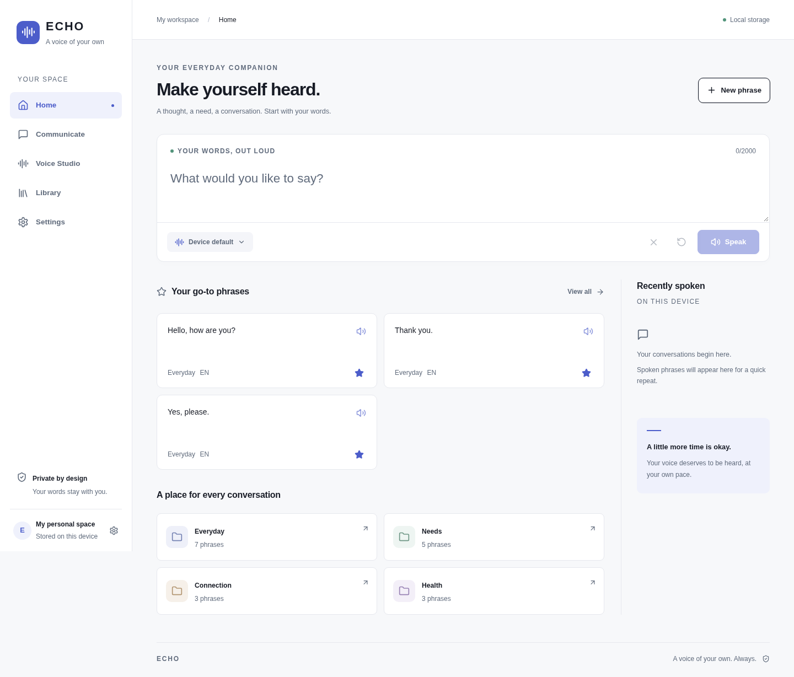

# ECHO NEXT 1.0.1

A local-first AAC application for adults. React 19, strict TypeScript, Vite, Tailwind CSS, Capacitor 7 and Android Java plugins power the browser and Android builds.



## Develop

Requires Node 24 (tested), npm 11. Dependencies are pinned by `package-lock.json`.

```sh
npm ci
npm run dev
npm run build
npm test
npm run test:e2e
```

Browser tests use `/usr/bin/chromium` by default; change `playwright.config.ts` to your browser installation on other machines. `npm run preview -- --port 4173` serves the production build. Microphone access requires HTTPS or a local development origin. Browser speech availability and offline capability depend on installed system voices. No account, API key or backend is required.

## Android APK

Requires a **JDK 21 with javac**, Android SDK platform 35, Build Tools 34 and 35, accepted Android SDK licenses. The project targets SDK 35 and supports Android 8/API 26+. A current Android System WebView is required. It does not yet target the latest Play Store submission requirements for every release date; recheck policy before publishing.

```sh
# Managed cloud: installs/refreshes toolchains and web dependencies without disabling TLS.
bash scripts/setup-cloud.sh
source scripts/cloud-env.sh
npm run android:apk
# Output: android/app/build/outputs/apk/debug/app-debug.apk
```

On another machine, set `JAVA_HOME` and `ANDROID_HOME` for your installations and create ignored `android/local.properties` with `sdk.dir=/your/android/sdk`. Run `npm run android:apk`. Gradle's distribution is checksum pinned. SDK downloads retain signature/checksum verification. Cloud setup uses the platform CA trust store and inherited proxy, with no credential values in scripts. Do not use the cloud-only paths on a normal workstation.

The debug APK is installable for testing, not a signed production release. For a release, configure your own signing outside source control and run `./gradlew assembleRelease`. Never commit keystores or signing passwords.

## Implemented

- Five responsive screens: Home, Communicate, Voice Studio, Library, Settings.
- Phrase and category creation, editing, deletion; category deletion confirmation; phrase ordering, search, favorites and spoken history.
- IndexedDB persistence, schema version 1, validated transactional JSON restore, backup including audio, complete local data deletion.
- Browser speech engine; native Android TTS with voice enumeration, language selection, rate, pitch, cancellation, audio focus, pause/shutdown handling. Only installed local voices can work offline.
- Browser MediaRecorder and native Android AAC recording with runtime microphone permission, denial errors, 60-second limit, pause cleanup, playback and deletion. Limit: 100 clips / 30 MB total raw audio.
- Voice profiles, English/Russian/Belarusian interface and phrase languages, light/dark/system appearance, text and card sizing, reduced motion.
- Optional local neural speech: Kokoro for English and Supertonic 3 for its 31 published languages, including Russian. Previously installed model files are restored from local cache without a network fallback. New downloads remain an explicit user action.
- Supertonic Fast (5), Balanced (8) and Quality (12) inference modes, serialized generation, cancellation, style reuse, long-text chunking and measured generation time in the current session.
- SHA-256 metadata detects later corruption of locally cached neural model files. Existing legacy caches are baselined in place; this local check is not an upstream signature.
- PWA manifest and versioned production shell cache; offline use after the initial successful installation/cache. Android packages the web assets for offline launch.
- Keyboard controls, native modal focus trapping, focus styles, screen-reader labels, minimum touch targets, reduced motion and automated contrast checks.

## Architecture and privacy

`src/app/App.tsx` coordinates screens and local state. `src/database/store.ts` owns schemas, CRUD transformations, IndexedDB transactions and backups. `src/services/speech.ts` selects the browser/native adapter through a common `SpeechEngine`. `src/services/recorder.ts` owns microphone resources. Android plugins live under `android/app/src/main/java/app/echo/communication/`: EchoSpeech, EchoRecorder and EchoFiles (system document picker for backup export). Capacitor App handles native background transitions. There is no analytics SDK or automatic audio upload. Android cloud backup is disabled.

State writes are serialized; UI failures show a storage error rather than claiming a successful save. Backup input is size limited (50 MB), structurally validated with Zod and checked for duplicate/orphan identifiers before a single transaction replaces data. Recorded files use supported audio MIME types. Backups are plain JSON containing sensitive data; keep them in a trusted location. Browser/OS storage eviction remains possible; export backups regularly. This version does not implement application-level database encryption.

Migration policy: IndexedDB's `upgrade` callback creates schema 1. Future versions must add explicit, tested transactional upgrades and backup-version migrations. Unknown backup versions are rejected, never silently coerced. No previous ECHO database is read or overwritten.

## Validation and limits

See [validation report](docs/VALIDATION.md) for executed checks and physical-device requirements. Browser microphone tests use Chromium's synthetic capture device, not a physical microphone. Automated speech tests verify adapter behavior; they do not establish audible output quality.

AI voice cloning is not implemented: recordings remain ordinary local audio clips and the UI requires owner consent before any future personalized synthesis. No AI model is bundled in the APK. Kokoro supports English in this integration; Supertonic's published list does not include Belarusian, so ECHO never labels Russian synthesis as Belarusian. See [model and language assessment](docs/ADDITIONAL-TTS-MODELS.md). Physical-device Android speech, recording, model download/restore, permissions, audio routing, TalkBack, backgrounding, memory/thermal behavior and OEM compatibility require verification before release. No iOS project or store deployment is included.

Release details and known limits are recorded in [the 1.0.1 release notes](docs/RELEASE-1.0.1.md).

## GitHub automation

See the [repository README](../README.md) for Pages setup, CI runs and APK artifact downloads. Deploy with `VITE_BASE_PATH=/ECHO-NEXT-/`; ordinary web and Android builds keep `/`. Fragment routes such as `#library` support reloads and browser history without server rewrite rules.
